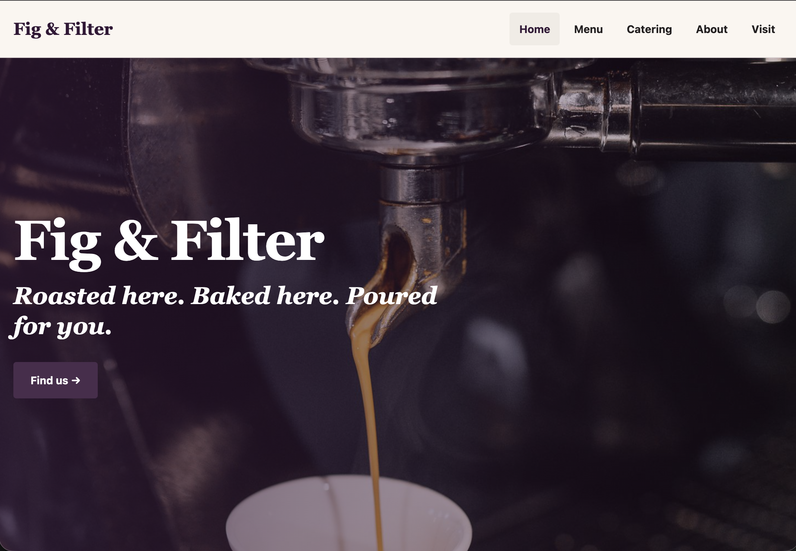
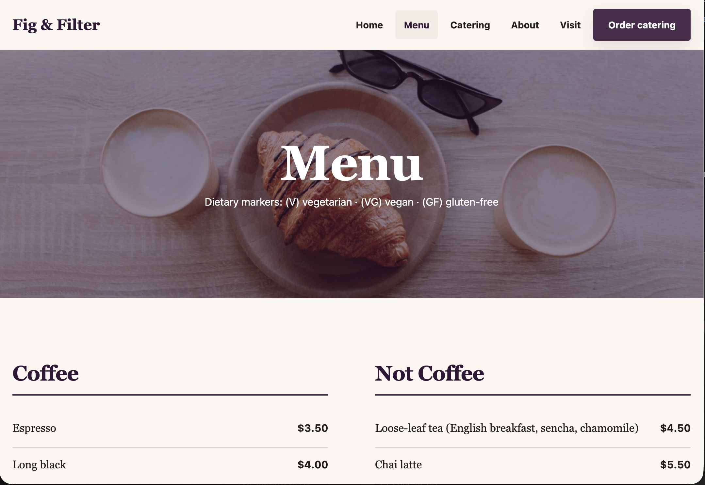

# Fig & Filter

A five-page static website for Fig & Filter, a neighbourhood café and roastery. The site follows the visual direction in `DESIGN.md` and the reference screens in `design/`, while using the supplied copy and photographs from `content/`.

### Home

### Menu


## Pages

- `index.html` — home page
- `menu.html` — coffee, kitchen, and bakery menu
- `catering.html` — catering packages and ordering details
- `about.html` — café story, founders, and roasting note
- `visit.html` — address, opening hours, directions, and contact details

All pages share `styles.css`. The only JavaScript is the inline mobile-navigation toggle included on each page.

## Project structure

```text
.
├── index.html
├── menu.html
├── catering.html
├── about.html
├── visit.html
├── styles.css
├── images/             # Deployed copies of the eight supplied photographs
├── content/            # Source copy and original image manifest
├── design/             # Page design references
└── DESIGN.md           # Design system and implementation direction
```

## View locally

The site has no dependencies or build step. Open `index.html` directly in a browser, or serve the folder with any static file server. For example:

```bash
python3 -m http.server 8000
```

Then visit `http://localhost:8000`.

## Implementation requirements

- Plain HTML and CSS, with JavaScript used only for mobile navigation
- Navigation collapses below `768px`
- Layout avoids horizontal scrolling at `375px`
- Body text is at least `16px`
- Links and buttons provide a minimum `44px` touch target
- Each page has one visually primary call to action
- All eight photographs use lower-case local paths and appear only on manifest-approved pages
- Every photograph uses the alt text supplied in `content/images/images.md`
- No externally hosted images
